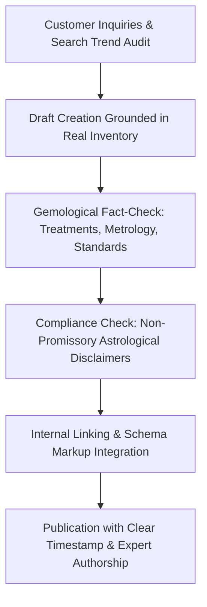

# GULSHAN JEWELLERS — TOPICAL AUTHORITY & CONTENT STRATEGY PLAN

*Document Version:* 1.0 (Production Release)  
*Atelier Baseline:* Gulshan Jewellers | Est. 1950  
*Target Audience:* Discerning Indian & global fine jewellery collectors, gemstone enthusiasts, bespoke commission clients, and families evaluating heirlooms.

---

## 1. Editorial Mission & Content Philosophy

In the Indian jewellery landscape, search results are crowded with automated affiliate listicles, aggressive astrological guarantees, and commercial portals masking synthetic treatments. 

Gulshan Jewellers' topical authority is built upon an opposing, high-trust premise:
1. **Unflinching Gemological Truth:** Every treatment, thermal enhancement, fracture filling, or oiling level must be named with technical precision.
2. **Respectful Astrological Demarcation:** Acknowledge traditional Vedic cultural significance while explicitly maintaining non-promissory scientific boundaries.
3. **Master Artisan Transparency:** Clarify metallurgical purities (22K 916, 18K 750, 14K 585, 925 Sterling), hallmarking conventions, and physical fabrication methods.
4. **No Fluff or Manufactured Claims:** Content is written to answer high-stakes consumer dilemmas, directly pointing readers to real products and atelier specialists.

---

## 2. Gemological & Metallurgical Accuracy Standards

Before any article is published, it must comply with these codified technical standards:

### Standard Weight Conventions (Pakka Ratti vs Sunari Ratti)
- **Standard Pakka Ratti (Gemological):**  
  $$1\text{ Pakka Ratti} = 182\text{ mg} = 0.91\text{ carats}$$  
  This is the universal standard employed by certified gemological laboratories and ethical gemstone traders.
- **Traditional Sunari Ratti (Goldsmith):**  
  $$1\text{ Sunari Ratti} = 121.5\text{ mg} \approx 0.6075\text{ carats}$$  
  Historically used for measuring rough gold alloys.  
- **Editorial Rule:** Any article or product mentioning "Ratti" must explicitly specify "Pakka Ratti" and provide the exact mathematical metric carat equivalent ($1\text{ ct} = 200\text{ mg}$).

### Treatment & Enhancement Disclosures
- **Sapphires (Corundum):** Never claim a sapphire is "unheated" solely based on visible rutile silk needles under 10x magnification. Unheated status requires microscopic examination of intact rutile silk, absence of discoid heat fractures, and spectroscopic laboratory verification.
- **Emeralds (Beryl):** Differentiate traditional colorless cedarwood oiling (a reversible, universally accepted clarity enhancement) from permanent artificial resins (e.g., Opticon, polymer infusions) or green dye infusions, which destroy investment value.
- **Rubies:** Strictly disclose any thermal enhancement. Condemn lead-glass composite filling, which transforms low-grade corundum into fragile composites that dissolve in jeweller's pickling acid.
- **Diamonds:** Explicitly differentiate earth-mined diamonds from lab-grown CVD/HPHT diamonds in all descriptive copy.

---

## 3. High-Priority Content Expansion Roadmap

### Topic 1: The Essential Guide to Buying Pukhraj (Yellow Sapphire) in India
- **Target Customer & Intent:** High-intent buyers purchasing a Yellow Sapphire for Jupiter (Brihaspati) wear or bespoke gold signets. (Informational to Commercial Investigation)
- **Primary Keyword:** `how to buy pukhraj stone india`
- **Secondary Keywords:** `original yellow sapphire price per carat`, `ceylon vs bangkok pukhraj`, `unheated pukhraj identification`, `pukhraj ring 22k gold`
- **The Core Question Answered:** How can a buyer distinguish genuine unheated Ceylon yellow sapphire from beryllium-diffused or synthetic corundum, and what setting maximizes longevity?
- **Detailed Article Outline:**
  1. Geological origin: Why Ratnapura (Sri Lanka) produces the benchmark canary-yellow crystals with high transparency.
  2. The treatment spectrum: Unheated vs Simple Heat vs Beryllium Lattice Diffusion (and why diffusion must be avoided).
  3. Pakka Ratti calculation: How to calculate your prescribed weight correctly without being shortchanged.
  4. Setting considerations: Solid 22K gold vs Panchdhatu vs 18K white gold; open-back basket requirements for light transmission.
  5. Laboratory certifications: Why an independent lab certificate (IIGJ, GIA, IGI) is non-negotiable.
- **Internal Linking Target:**
  - Collection: `/collections.html?category=gemstones`
  - PDP: `/products/pukhraj-cushion-signet-22k.html`
  - Pillar Guide: `/gemstone-guide.html`
- **Fact-Checking Requirement:** Verified by a senior gemologist (Ceylon origin indicators, diffusion detection protocols).
- **Publication Priority:** Critical (P1)

---

### Topic 2: Pakka Ratti vs Carat: The Definitive Weight Conversion Guide
- **Target Customer & Intent:** Consumers whose family pandit or astrologer recommended a specific Ratti weight and need to purchase stone inventory measured in carats. (Informational)
- **Primary Keyword:** `ratti to carat conversion jewellery`
- **Secondary Keywords:** `pakka ratti vs sunari ratti`, `how many carats in 5 ratti`, `gemstone ratti calculator`, `milligrams in one ratti`
- **The Core Question Answered:** Why do different jewellers give conflicting carat numbers for the same Ratti recommendation, and what is the exact mathematical conversion?
- **Detailed Article Outline:**
  1. The historical origins of the Ratti seed (*Abrus precatorius*) in ancient Indian metrology.
  2. The mathematical split: Pakka Ratti (182 mg / 0.91 ct) vs Sunari Ratti (121.5 mg / ~0.61 ct).
  3. Interactive conversion cheat sheet: 3.25 Ratti, 4.25 Ratti, 5.25 Ratti, 7.25 Ratti mapped to exact carats and milligrams.
  4. How disreputable sellers exploit the Sunari ratti to sell underweight stones at full price.
  5. Why international testing labs only certify in metric carats (ct).
- **Internal Linking Target:**
  - Guide: `/gemstone-guide.html#ratti-conversion`
  - PDPs: `/products/pukhraj-cushion-signet-22k.html`, `/products/neelam-royal-blue-baguette-18k.html`
- **Fact-Checking Requirement:** Verified against Bureau of Indian Standards (BIS) and gemological laboratory metrology conventions.
- **Publication Priority:** Critical (P1)

---

### Topic 3: Understanding Emerald Clarity: "Jardin" vs Treatment vs Synthetic
- **Target Customer & Intent:** Buyers confused by internal inclusions in natural emeralds or comparing low-cost stones online. (Commercial Investigation)
- **Primary Keyword:** `natural emerald clarity jardin guide`
- **Secondary Keywords:** `colombian emerald oiling treatments`, `minor vs moderate oil panna`, `how to clean emerald jewelry`, `panna stone inclusion guide`
- **The Core Question Answered:** Are inclusions in emeralds flaws or proof of nature? How much oiling is acceptable, and how does one care for emerald jewellery?
- **Detailed Article Outline:**
  1. The chemistry of green beryl: Why chromium and vanadium crystallization inevitably creates three-phase inclusions (the *jardin*).
  2. Oiling standards: Traditional colorless cedarwood oil vs polymer resin fillings; why lab reports specify "Minor", "Moderate", or "Significant" clarity enhancement.
  3. Colombian (Muzo/Chivor) vs Zambian vs Brazilian characteristics.
  4. Setting emeralds securely: The protective role of bezel and rubover settings.
  5. Daily care rules: Why emeralds must never enter an ultrasonic cleaner or encounter harsh steam.
- **Internal Linking Target:**
  - PDP: `/products/emerald-colombian-bezel-pendant.html`
  - Collection: `/collections.html?category=gemstones`
  - Bespoke: `/bespoke.html`
- **Fact-Checking Requirement:** Gemological lab verification of microscopic three-phase inclusion definitions and cedarwood oil reversibility.
- **Publication Priority:** High (P2)

---

### Topic 4: Blue Kyanite vs Blue Sapphire: The Honest Up-Ratna Comparison
- **Target Customer & Intent:** Buyers seeking authentic Saturn resonance or deep blue jewellery beauty without a multi-lakh expenditure. (Commercial Investigation)
- **Primary Keyword:** `blue kyanite vs blue sapphire neelam`
- **Secondary Keywords:** `neelam upratna options`, `natural kyanite stone benefits`, `affordable blue gemstone ring`, `kyanite jewellery 925 silver`
- **The Core Question Answered:** Can natural untreated Himalayan Blue Kyanite serve as an ethical, natural alternative to Ceylon Blue Sapphire, and how do their physical properties compare?
- **Detailed Article Outline:**
  1. The Up-ratna tradition in Indian gemology: Choosing natural minor stones over heat-treated or glass-filled major stones.
  2. Physical comparison: Hardness (Mohs directional hardness of Kyanite 4.5–7 vs Sapphire 9), refractive index, and pleochroism.
  3. Pricing transparency: Why natural Kyanite provides untreated earth-mined integrity at an accessible price point.
  4. Setting and durability: Why Kyanite should be bezel-set in heavy solid 925 sterling silver for impact protection.
- **Internal Linking Target:**
  - PDP: `/products/kyanite-artisan-silver-ring.html`
  - PDP: `/products/neelam-royal-blue-baguette-18k.html`
  - Guide: `/gemstone-guide.html`
- **Fact-Checking Requirement:** Mineralogical validation of Kyanite directional hardness (*disthene*) and safe jewellery setting techniques.
- **Publication Priority:** High (P2)

---

### Topic 5: Decoding BIS Hallmarking: 916, 750, 585 & HUID Numbers Explained
- **Target Customer & Intent:** Buyers purchasing gold jewellery who want to independently verify purity marks and avoid alloy adulteration. (Informational & Trust Building)
- **Primary Keyword:** `how to read gold hallmark india huid`
- **Secondary Keywords:** `difference between 22k 18k gold`, `bis 916 meaning`, `huid 6 digit code verification`, `hallmarked gold jewelry Delhi`
- **The Core Question Answered:** What do the symbols inside your gold ring actually mean, and how does the government HUID portal protect you?
- **Detailed Article Outline:**
  1. The anatomy of modern BIS Hallmarking: The BIS triangle, purity mark (916 for 22K, 750 for 18K, 585 for 14K), and the unique 6-digit alphanumeric HUID.
  2. Step-by-step verification using the BIS Care mobile application.
  3. Choosing your gold purity: 22K for heirloom richness vs 18K/14K for diamond daily-wear tensile strength.
  4. Gulshan Jewellers' seven-decade policy of zero-tolerance purity auditing.
- **Internal Linking Target:**
  - Collections: `/collections.html?category=gold`
  - PDP: `/products/handcrafted-18k-gold-solitaire-ring.html`
  - Bespoke: `/bespoke.html`
  - About: `/about.html`
- **Fact-Checking Requirement:** Cross-referenced against official Bureau of Indian Standards (BIS) Hallmarking Order 2021/2023 regulations.
- **Publication Priority:** High (P2)

---

### Topic 6: The Bespoke Fine Jewellery Commission Journey
- **Target Customer & Intent:** Clients wanting custom engagement rings, anniversary gifts, or resetting ancestral jewellery into contemporary heirlooms. (Commercial Investigation & Transactional)
- **Primary Keyword:** `bespoke jewellery design process Delhi`
- **Secondary Keywords:** `custom gemstone ring maker`, `remounting grandmother heirloom jewelry`, `how long does custom jewellery take`, `private goldsmith consultation`
- **The Core Question Answered:** What happens during a bespoke commission from initial sketch to final hallmarked piece, and how are budgets managed?
- **Detailed Article Outline:**
  1. Phase 1: Conversation & stone curation (sourcing certified loose gems or evaluating client stones).
  2. Phase 2: Hand sketches, wax models, and proportion refinement.
  3. Phase 3: Forging on the anvil, bezel fabrication, and master setting.
  4. Phase 4: Government hallmarking, independent laboratory certification, and private handover.
  5. Transparent deposit and alteration policies (complimentary first resizing).
- **Internal Linking Target:**
  - Page: `/bespoke.html`
  - Contact: `/contact.html`
  - Collections: `/collections.html`
- **Fact-Checking Requirement:** Verified against Gulshan Jewellers atelier production timelines (standard 14–21 business days).
- **Publication Priority:** Medium (P3)

---

## 4. Editorial Integrity & Review Workflow

1. **No Ghostwritten Fiction:** Authorship must clearly reflect atelier senior goldsmiths or licensed gemological contributors.
2. **Transparent Updates:** Any post-publication changes to testing standards or government regulations must be reflected with explicit revision notes.
3. **No Fabricated Reviews or Claims:** Customer cases discussed must reflect genuine atelier commissions with client consent.
